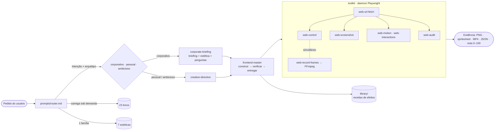

<p align="center">
  <a href="https://anthophicous.github.io/parede-da-ia/"></a>
</p>

<p align="center">
  <a href="https://anthophicous.github.io/parede-da-ia/"></a>
  
  <a href="LICENSE"></a>
  
  
  
  
</p>

<h3 align="center">Olhos, mãos e repertório para agentes de IA.</h3>

<p align="center">
  Skill open-source que transforma <b>Claude Code</b>, <b>Codex</b>, <b>OpenCode</b>, <b>Cursor</b>
  (e qualquer CLI agêntica) em diretores de arte e engenheiros front-end que <b>veem</b> o que constroem.
</p>

---

## Por quê

Agentes de IA escrevem interface sem nunca ver a tela. Não sentem o scroll, não medem o contraste,
não percebem o pre-loader travado nem o botão que quebra no mobile — e por isso entregam o
template médio e dizem "pronto" sem ter testado.

O **parede-da-ia** resolve isso em três camadas:

1. **Toolkit (`/toolkit`)** — 16 comandos (`web-*` e `media-frames`) sobre **Playwright + FFmpeg** para o agente abrir,
   rolar, clicar, arrastar, gravar frames, medir movimento e microinterações, auditar e dissecar
   qualquer site (stack, fontes, paleta, shaders, contraste, rede).
2. **Router de prompts (`/prompts`)** — um despachante que identifica a tarefa e o **arquétipo** do
   projeto (corporativo, pessoal ou ambicioso) e carrega sob demanda só o necessário: **23 livros**
   destilados, **7 estéticas** com playbooks medidos em sites reais, workflows e templates.
3. **Library (`/library`)** — receitas de efeitos prontas para usar e adaptar: Hover Font, text
   morph de partículas, magnético, rastro de pixels, canvas arrastável, campo de gradiente.

## Instalação em 1 prompt

Cole no seu agente (Claude Code, Codex, OpenCode, Cursor, Windsurf, Gemini CLI):

```text
Instale o parede-da-ia no meu ambiente.
Leia https://raw.githubusercontent.com/AnThophicous/parede-da-ia/main/doc.md
e execute todas as etapas na ordem, verificando a saída de cada uma antes de seguir.
Use o meu terminal; se algo exigir permissão de administrador, me pergunte antes.
No final, mostre o resultado do `parede doctor` e em quais agentes o router foi registrado.
```

<details>
<summary>Instalação manual</summary>

```bash
git clone --depth 1 https://github.com/AnThophicous/parede-da-ia.git ~/.parede-da-ia
cd ~/.parede-da-ia/toolkit && npm install && npx playwright install chromium
npm link                       # coloca web-*, media-frames e parede no PATH
parede setup --agent auto      # registra o router no Claude Code / Codex / OpenCode / Gemini / Windsurf
parede doctor
```

Passo a passo completo (inclui FFmpeg, MCP, atualização e troubleshooting): [`doc.md`](doc.md).
</details>

## Como funciona



```
parede-da-ia/
├── doc.md                    instalador universal lido pelo agente
├── prompts/
│   ├── router.md             ponto de entrada: intenção, arquétipo, portões de qualidade
│   ├── workflows/            frontend-master · corporate-briefing · creative-direction ·
│   │                         reference-teardown · motion-teardown
│   ├── aesthetics/           7 famílias + matriz de decisão + biblioteca de blurs
│   ├── knowledge-base/       01…23 — heurísticas e checklists por livro
│   └── templates/            briefing corporativo · direção criativa · motion spec · relatório
├── library/                  receitas: motion/ · particles/ · gradients/ · loaders/
├── toolkit/                  CLI + daemon + servidor MCP (TypeScript, Clean Architecture)
│   ├── src/domain/           regras puras: ações, cores, auditoria, estética, tokens
│   ├── src/application/      portas (BrowserSession, MediaEncoder…) e casos de uso
│   ├── src/infrastructure/   Playwright, FFmpeg, sessão, scripts injetados no DOM
│   └── src/presentation/     CLI, formatadores e MCP (JSON-RPC sobre stdio)
├── skill/SKILL.md            template da skill do Claude Code
└── site/                     landing (React + Vite), publicada no GitHub Pages
```

Os comandos são clientes leves de um **daemon local** (127.0.0.1 + token) que mantém um único
Chromium vivo entre chamadas. Por isso o estado persiste, a rede é escutada a sessão inteira e
`web-control` pode agir **enquanto** `web-record-frames` grava.

## Toolkit

| Comando | O que faz |
|---------|-----------|
| `web-url-fetch <url>` | Abre a URL num Chromium persistente e injeta hooks (canvas, shaders GLSL, WAAPI, rAF, console, Web Vitals). Aceita `localhost`, arquivos locais, `--mobile`, `--viewport`, `--dpr`, `--reduced-motion`. |
| `web-wait-page-load` · `web-wait <s>` | Espera `load` + rede + fontes; fallback para pre-loaders em canvas/WebGL (`--until-hidden`). |
| `web-control <ação>` | Eventos **reais**: `scroll-down/up/to`, `click`, `hover`, `mousemove`, `drag`, `keypress`, `type`, `inventory` e `sequence "a; b; c"`. |
| `web-eval "<js>"` | Lê estado da página para inspeção. |
| `web-screenshot` | Alta definição re-rasterizada no DPR pedido, viewport/página/elemento, `--viewports desktop,tablet,mobile`, `--hide-banners`. |
| `web-record-frames` | Screencast a cada **0.5s** → frames + **spritesheet** + **MP4** (+ GIF); `--while "<ações>"`, `--selector` para microinterações de perto, fps e jank no manifesto. |
| `web-scrap` | **Wappalyzer de front-end**: frameworks e libs, fontes, ícones, paleta exata, contraste WCAG, escala tipográfica, espaçamento, mídia, shaders, rede e a **família estética** provável. |
| `web-motion` | O que anima, durações, curvas, fps e frames longos — inclusive GSAP/Motion empacotados (`--observe`, `--while`). |
| `web-interactions` | Hover, foco e `:active` de cada interativo, com folha antes/hover/foco e detecção de efeito magnético. |
| `web-audit` | Nota 0–100 por viewport: acessibilidade (contraste, foco visível, alvos de toque), responsivo, performance (CLS, LCP, long tasks), SEO, console e movimento. `--strict` para CI. |
| `web-tokens` | Exporta cores, tipos, espaços e movimento como CSS + JSON. |
| `web-diff` | Compara duas capturas (SSIM/PSNR + imagem de diferença). |
| `media-frames` | Extrai frames e folha de contato de vídeos de referência (MP4, gravações de tela). |
| `web-serve <pasta> --detach` | Servidor estático sem cache para o loop de QA. |
| `parede doctor` · `parede setup` | Diagnóstico da instalação e registro idempotente do router nos agentes. |
| `parede-mcp` | Os mesmos comandos como ferramentas MCP (stdio). |

```bash
web-url-fetch https://seu-site.com && web-wait-page-load
web-scrap                                                       # stack, fontes, paleta, estética
web-motion --observe 6 --while "scroll-down 4000 --steps 80"    # coreografia e fps
web-record-frames --while "scroll-down 4000 --steps 80" --interval 0.25
web-interactions --limit 12                                     # hover/foco de cada interativo
web-audit --viewports desktop,tablet,mobile                     # portão de qualidade
web-close
```

> ⚠ **Consumo:** cada frame é uma captura real. Intervalos abaixo de `0.1s`, viewports enormes ou
> cenas WebGL pesadas exigem bastante CPU/RAM/GPU. Em máquinas modestas use `--interval 0.25–0.5`
> e viewport ≤ 1440px. O manifesto de cada gravação informa `laggedFrames`.

## Arquétipos e estéticas

O router decide **antes** de qualquer código:

| Arquétipo | Sinais | O agente faz |
|-----------|--------|--------------|
| **Corporativo** | empresa, institucional, B2B, SaaS, conversão de leads | pede **briefing** e escolha de estética, faz perguntas extras; base minimalista-modernista, economia visual |
| **Pessoal / portfólio** | "meu portfólio", designer, dev, artista | direção criativa curta com foco em personalidade |
| **Ambicioso / experiência** | "nível Awwwards", WebGL, imersivo | define um **ápice visual** e coreografa scroll e cursor |

| Família | Essência |
|---------|----------|
| `corporativo-modernista` | Suíço, econômico, grid rígido, uma cor de acento, movimento mínimo |
| `corporativo-marca` | A marca protagoniza: cor forte, display arredondado, formas orgânicas |
| `produto-saas` | O produto é o herói: UI real, provas, demo |
| `canvas-ludico` | Prancheta de designer viva e arrastável |
| `editorial-brutalista` | Contraste tipográfico extremo, monocromia, assimetria |
| `gradiente-atmosferico` | Campos de cor desfocados, grão, vidro (biblioteca de blurs) |
| `imersivo-webgl` | Cena 3D viva, partículas, física |

Os playbooks foram construídos a partir de referências medidas com a própria toolkit.

## A base de 23 livros

| # | Módulo | Obra |
|---|--------|------|
| 01 | Legibilidade, funções pequenas, nomes | *Clean Code* — Robert C. Martin |
| 02 | Regra da dependência, UI como detalhe | *Clean Architecture* — Robert C. Martin |
| 03 | Navegação óbvia, carga cognitiva | *Don't Make Me Think, Revisited* — Steve Krug |
| 04 | Percepção, atenção, conversão | *100 Things Every Designer Needs to Know About People* — Susan Weinschenk |
| 05 | Hierarquia, espaçamento, tipografia | *Refactoring UI* — Adam Wathan & Steve Schoger |
| 06 | DRY, ortogonalidade, tracer bullets | *The Pragmatic Programmer* — Andrew Hunt & David Thomas |
| 07 | Commits atômicos, histórico semântico | *Pro Git* — Scott Chacon & Ben Straub |
| 08 | Telemetria, avaliação contínua | *Designing Machine Learning Systems* — Chip Huyen |
| 09 | Direção, formato, exemplos, decomposição | *Prompt Engineering for Generative AI* — James Phoenix & Mike Taylor |
| 10 | Confiabilidade, consistência, fluxo assíncrono | *Designing Data-Intensive Applications* — Martin Kleppmann |
| 11 | Gatilho, regras, feedback, loops | *Microinteractions* — Dan Saffer |
| 12 | Os 12 princípios da animação | *The Illusion of Life* — Frank Thomas & Ollie Johnston |
| 13 | Propósito, duração e coreografia do movimento | *Designing Interface Animation* — Val Head |
| 14 | Letra, texto e grid tipográfico | *Thinking with Type* — Ellen Lupton |
| 15 | Grid modular, espaço ativo | *Grid Systems in Graphic Design* — Josef Müller-Brockmann |
| 16 | Cor relativa, contraste simultâneo | *Interaction of Color* — Josef Albers |
| 17 | Shaders, ruído, campos de distância | *The Book of Shaders* — Patricio Gonzalez Vivo & Jen Lowe |
| 18 | Affordances, significantes, mapeamento | *The Design of Everyday Things* — Don Norman |
| 19 | Identidade, sistema de marca | *Designing Brand Identity* — Alina Wheeler |
| 20 | Fitts, Hick, Jakob e companhia | *Laws of UX* — Jon Yablonski |
| 21 | Átomos → páginas, design system | *Atomic Design* — Brad Frost |
| 22 | Componentes acessíveis de verdade | *Inclusive Components* — Heydon Pickering |
| 23 | Narrativa e mensagem que convertem | *Building a StoryBrand* — Donald Miller |

Os módulos são **destilações autorais** (heurísticas e checklists para agentes), não transcrições.
Os livros pertencem aos seus autores — leia os originais.

## Protocolo `frontend-master`

0. **Classificar** — intenção, arquétipo e candidatas de estética, num contrato curto.
1. **Elicitar** — nada de código de UI antes disso: briefing corporativo, direção criativa ou o ápice
   visual, referências e como os assets serão geridos.
2. **Construir em fatias** — tracer bullet: estrutura, conteúdo real, depois movimento.
3. **Verificar com os próprios olhos** — loop autônomo: abre o próprio trabalho, testa hover, foco e
   scroll, grava frames, mede movimento e roda o `web-audit` até passar nos portões do router.
4. **Entregar** — relatório com as evidências (capturas, notas, o que ficou de fora).

## A landing

[anthophicous.github.io/parede-da-ia](https://anthophicous.github.io/parede-da-ia/) — React 19,
Vite, Tailwind 4, shadcn/ui, Paper Shaders, three.js, GSAP e Lenis. Existe para uma coisa: você
instalar a skill. Usa receitas da própria `library/` (Hover Font no título, text morph de partículas)
e passou pelo loop com a toolkit: `web-audit` aprovado com 99/100 em desktop, tablet e mobile,
foco visível e hover em todos os interativos.

## Desenvolvimento

```bash
cd toolkit
npm install          # compila via "prepare"
npm run typecheck
npm run smoke        # teste ponta a ponta de todos os comandos

cd ../site
npm install
npm run dev          # landing em http://localhost:5173/parede-da-ia/
npm run og           # regenera public/og.jpg com a própria toolkit
```

Variáveis: `PAREDE_SESSION` (sessões paralelas), `PAREDE_OUT` (pasta de artefatos, padrão `./.parede`),
`PAREDE_FFMPEG`, `PAREDE_GPU=0` (força SwiftShader), `PAREDE_IDLE_MINUTES` (padrão 30).

Histórico de versões: [`CHANGELOG.md`](CHANGELOG.md).

## Licença

[MIT](LICENSE) © 2026 Brenno Leon
