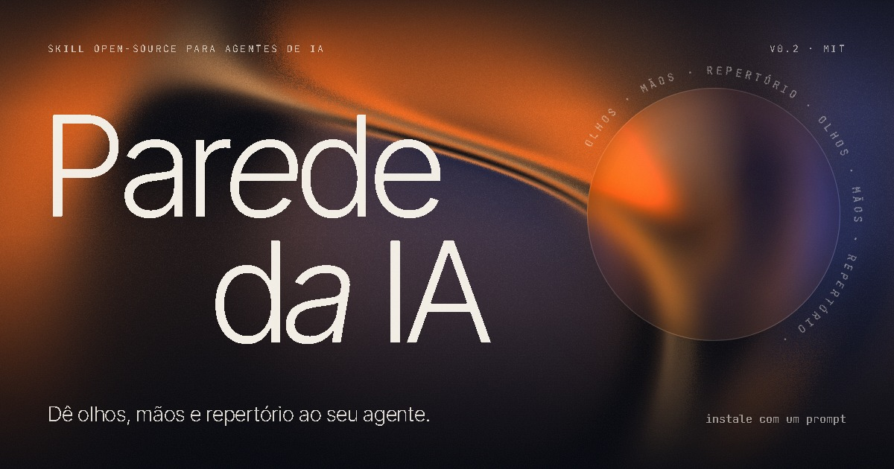
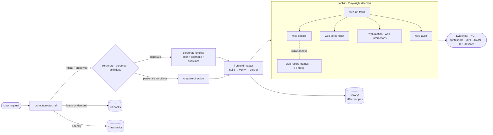

<p align="center">
  <a href="https://anthophicous.github.io/parede-da-ia/"></a>
</p>

<p align="center">
  <a href="https://anthophicous.github.io/parede-da-ia/"></a>
  
  <a href="LICENSE"></a>
  
  
  
  
</p>

<h3 align="center">Eyes, hands and taste for AI agents.</h3>

<p align="center">
  An open-source skill that turns <b>Claude Code</b>, <b>Codex</b>, <b>OpenCode</b>, <b>Cursor</b>
  (and any agentic CLI) into art directors and front-end engineers who <b>see</b> what they build.
</p>

---

## Why

AI agents write interfaces without ever seeing the screen. They don't feel the scroll, don't measure
contrast, don't notice the stuck preloader or the button that breaks on mobile — so they ship the
average template and say "done" without testing it.

**parede-da-ia** fixes that in three layers:

1. **Toolkit (`/toolkit`)** — 16 commands (`web-*` and `media-frames`) on top of **Playwright + FFmpeg** so the agent can open,
   scroll, click, drag, record frames, measure motion and microinteractions, audit and dissect
   any site (stack, fonts, palette, shaders, contrast, network).
2. **Prompt router (`/prompts`)** — a dispatcher that identifies the task and the project
   **archetype** (corporate, personal or ambitious) and loads only what is needed, on demand:
   **23 distilled books**, **7 aesthetics** with playbooks measured on real sites, workflows and templates.
3. **Library (`/library`)** — effect recipes ready to use and adapt: Hover Font, particle text
   morph, magnetic, pixel trail, draggable canvas, gradient field.

## Install with one prompt

Paste this in your agent (Claude Code, Codex, OpenCode, Cursor, Windsurf, Gemini CLI):

```text
Install parede-da-ia in my environment.
Read https://raw.githubusercontent.com/AnThophicous/parede-da-ia/main/doc.md
and run every step in order, checking each output before moving on.
Use my terminal; ask me before anything that needs admin rights.
At the end, show me the output of `parede doctor` and which agents the router was registered in.
```

<details>
<summary>Manual install</summary>

```bash
git clone --depth 1 https://github.com/AnThophicous/parede-da-ia.git ~/.parede-da-ia
cd ~/.parede-da-ia/toolkit && npm install && npx playwright install chromium
npm link                       # puts web-*, media-frames and parede on the PATH
parede setup --agent auto      # registers the router in Claude Code / Codex / OpenCode / Gemini / Windsurf
parede doctor
```

The full walkthrough (FFmpeg, MCP, updating and troubleshooting): [`doc.md`](doc.md).
</details>

## How it works



```
parede-da-ia/
├── doc.md                    universal installer read by the agent
├── prompts/
│   ├── router.md             entry point: intent, archetype, quality gates
│   ├── workflows/            frontend-master · corporate-briefing · creative-direction ·
│   │                         reference-teardown · motion-teardown
│   ├── aesthetics/           7 families + decision matrix + blur library
│   ├── knowledge-base/       01…23 — heuristics and checklists per book
│   └── templates/            corporate brief · creative direction · motion spec · delivery report
├── library/                  recipes: motion/ · particles/ · gradients/ · loaders/
├── toolkit/                  CLI + daemon + MCP server (TypeScript, Clean Architecture)
│   ├── src/domain/           pure rules: actions, color, audit, aesthetics, tokens
│   ├── src/application/      ports (BrowserSession, MediaEncoder…) and use cases
│   ├── src/infrastructure/   Playwright, FFmpeg, session, scripts injected into the DOM
│   └── src/presentation/     CLI, formatters and MCP (JSON-RPC over stdio)
├── skill/SKILL.md            Claude Code skill template
└── site/                     landing (React + Vite), published on GitHub Pages
```

The commands are thin clients of a **local daemon** (127.0.0.1 + token) that keeps a single
Chromium alive between calls. That's why state persists, the network is observed for the whole
session and `web-control` can act **while** `web-record-frames` records.

## Toolkit

| Command | What it does |
|---------|--------------|
| `web-url-fetch <url>` | Opens the URL in a persistent Chromium and injects hooks (canvas, GLSL shaders, WAAPI, rAF, console, Web Vitals). Accepts `localhost`, local files, `--mobile`, `--viewport`, `--dpr`, `--reduced-motion`. |
| `web-wait-page-load` · `web-wait <s>` | Waits for `load` + network + fonts; a fallback for canvas/WebGL preloaders (`--until-hidden`). |
| `web-control <action>` | **Real** events: `scroll-down/up/to`, `click`, `hover`, `mousemove`, `drag`, `keypress`, `type`, `inventory` and `sequence "a; b; c"`. |
| `web-eval "<js>"` | Reads page state for inspection. |
| `web-screenshot` | High definition re-rasterized at the requested DPR, viewport/page/element, `--viewports desktop,tablet,mobile`, `--hide-banners`. |
| `web-record-frames` | A screencast every **0.5s** → frames + **spritesheet** + **MP4** (+ GIF); `--while "<actions>"`, `--selector` for close-up microinteractions, fps and jank in the manifest. |
| `web-scrap` | A **front-end Wappalyzer**: frameworks and libs, fonts, icons, exact palette, WCAG contrast, type scale, spacing, media, shaders, network and the likely **aesthetic family**. |
| `web-motion` | What animates, durations, easings, fps and long frames — even bundled GSAP/Motion (`--observe`, `--while`). |
| `web-interactions` | Hover, focus and `:active` of every interactive element, with a before/hover/focus sheet and magnetic-effect detection. |
| `web-audit` | A 0–100 score per viewport: accessibility (contrast, visible focus, touch targets), responsive, performance (CLS, LCP, long tasks), SEO, console and motion. `--strict` for CI. |
| `web-tokens` | Exports colors, type, spacing and motion as CSS + JSON. |
| `web-diff` | Compares two captures (SSIM/PSNR + a difference image). |
| `media-frames` | Extracts frames and a contact sheet from reference videos (MP4, screen recordings). |
| `web-serve <folder> --detach` | A no-cache static server for the QA loop. |
| `parede doctor` · `parede setup` | Install diagnostics and idempotent router registration in the agents. |
| `parede-mcp` | The same commands as MCP tools (stdio). |

```bash
web-url-fetch https://your-site.com && web-wait-page-load
web-scrap                                                       # stack, fonts, palette, aesthetic
web-motion --observe 6 --while "scroll-down 4000 --steps 80"    # choreography and fps
web-record-frames --while "scroll-down 4000 --steps 80" --interval 0.25
web-interactions --limit 12                                     # hover/focus of every interactive
web-audit --viewports desktop,tablet,mobile                     # quality gate
web-close
```

> ⚠ **Cost:** every frame is a real capture. Intervals below `0.1s`, huge viewports or heavy
> WebGL scenes need plenty of CPU/RAM/GPU. On modest machines use `--interval 0.25–0.5`
> and a viewport ≤ 1440px. Each recording's manifest reports `laggedFrames`.

## Archetypes and aesthetics

The router decides **before** any code:

| Archetype | Signals | The agent |
|-----------|---------|-----------|
| **Corporate** | company, institutional, B2B, SaaS, lead conversion | asks for a **brief** and an aesthetic choice, asks extra questions; a minimalist-modernist base, visual economy |
| **Personal / portfolio** | "my portfolio", designer, dev, artist | a short creative direction focused on personality |
| **Ambitious / experience** | "Awwwards level", WebGL, immersive | defines a **visual apex** and choreographs scroll and cursor |

| Family | Essence |
|--------|---------|
| `corporate-modernist` | Swiss, economical, strict grid, one accent color, minimal motion |
| `corporate-brand` | The brand leads: strong color, rounded display, organic shapes |
| `product-saas` | The product is the hero: real UI, proof, demo |
| `playful-canvas` | A living, draggable designer's artboard |
| `editorial-brutalist` | Extreme type contrast, monochrome, asymmetry |
| `atmospheric-gradient` | Blurred color fields, grain, glass (blur library) |
| `immersive-webgl` | A living 3D scene, particles, physics |

The playbooks were built from references measured with the toolkit itself.

## The 23-book base

| # | Module | Work |
|---|--------|------|
| 01 | Readability, small functions, names | *Clean Code* — Robert C. Martin |
| 02 | The dependency rule, UI as a detail | *Clean Architecture* — Robert C. Martin |
| 03 | Obvious navigation, cognitive load | *Don't Make Me Think, Revisited* — Steve Krug |
| 04 | Perception, attention, conversion | *100 Things Every Designer Needs to Know About People* — Susan Weinschenk |
| 05 | Hierarchy, spacing, typography | *Refactoring UI* — Adam Wathan & Steve Schoger |
| 06 | DRY, orthogonality, tracer bullets | *The Pragmatic Programmer* — Andrew Hunt & David Thomas |
| 07 | Atomic commits, semantic history | *Pro Git* — Scott Chacon & Ben Straub |
| 08 | Telemetry, continuous evaluation | *Designing Machine Learning Systems* — Chip Huyen |
| 09 | Direction, format, examples, decomposition | *Prompt Engineering for Generative AI* — James Phoenix & Mike Taylor |
| 10 | Reliability, consistency, async flow | *Designing Data-Intensive Applications* — Martin Kleppmann |
| 11 | Trigger, rules, feedback, loops | *Microinteractions* — Dan Saffer |
| 12 | The 12 principles of animation | *The Illusion of Life* — Frank Thomas & Ollie Johnston |
| 13 | Purpose, duration and choreography of motion | *Designing Interface Animation* — Val Head |
| 14 | Letter, text and typographic grid | *Thinking with Type* — Ellen Lupton |
| 15 | Modular grid, active space | *Grid Systems in Graphic Design* — Josef Müller-Brockmann |
| 16 | Relative color, simultaneous contrast | *Interaction of Color* — Josef Albers |
| 17 | Shaders, noise, distance fields | *The Book of Shaders* — Patricio Gonzalez Vivo & Jen Lowe |
| 18 | Affordances, signifiers, mapping | *The Design of Everyday Things* — Don Norman |
| 19 | Identity, brand system | *Designing Brand Identity* — Alina Wheeler |
| 20 | Fitts, Hick, Jakob and friends | *Laws of UX* — Jon Yablonski |
| 21 | Atoms → pages, design system | *Atomic Design* — Brad Frost |
| 22 | Truly accessible components | *Inclusive Components* — Heydon Pickering |
| 23 | Narrative and messaging that converts | *Building a StoryBrand* — Donald Miller |

The modules are **original distillations** (heuristics and checklists for agents), not transcriptions.
The books belong to their authors — read the originals.

## The `frontend-master` protocol

0. **Classify** — intent, archetype and candidate aesthetics, in a short contract.
1. **Elicit** — no UI code before this: a corporate brief, a creative direction or the visual
   apex, references and how assets will be handled.
2. **Build in slices** — tracer bullet: structure, real content, then motion.
3. **Verify with its own eyes** — an autonomous loop: it opens its own work, tests hover, focus and
   scroll, records frames, measures motion and runs `web-audit` until it passes the router's gates.
4. **Deliver** — a report with the evidence (captures, scores, what was left out).

## The landing

[anthophicous.github.io/parede-da-ia](https://anthophicous.github.io/parede-da-ia/) — React 19,
Vite, Tailwind 4, three.js and the Web Audio API, in black and white. It exists for one thing: you
installing the skill. "Parede da IA" is written by a single thread; a heavy breaker lever turns on
a generative, mathematically composed score (slow, bass-heavy, no voices); every beat launches a
star from the sides — each one a distilled book that turns into its cover when clicked — around a
black hole you can hover to see how far it is. Scrolling sets a slow, self-running journey in
motion: the hole grows, the event horizon pulses with the beat, the camera spaghettifies, loose
particles spell "Parade da IA" and solidify into "Parede da IA", the letters break into eyes that
watch you and blink, and everything turns white for the install card. It reuses the project's own
`library/` (the particle text morph) and went through the toolkit's QA loop (`web-audit` 99/100).

## Development

```bash
cd toolkit
npm install          # builds through "prepare"
npm run typecheck
npm run smoke        # end-to-end test of every command

cd ../site
npm install
npm run dev          # landing at http://localhost:5173/parede-da-ia/
npm run og           # rebuilds public/og.jpg with the toolkit itself
```

Variables: `PAREDE_SESSION` (parallel sessions), `PAREDE_OUT` (artifacts folder, default `./.parede`),
`PAREDE_FFMPEG`, `PAREDE_GPU=0` (forces SwiftShader), `PAREDE_IDLE_MINUTES` (default 30).

Version history: [`CHANGELOG.md`](CHANGELOG.md).

## License

[MIT](LICENSE) © 2026 Brenno Leon
