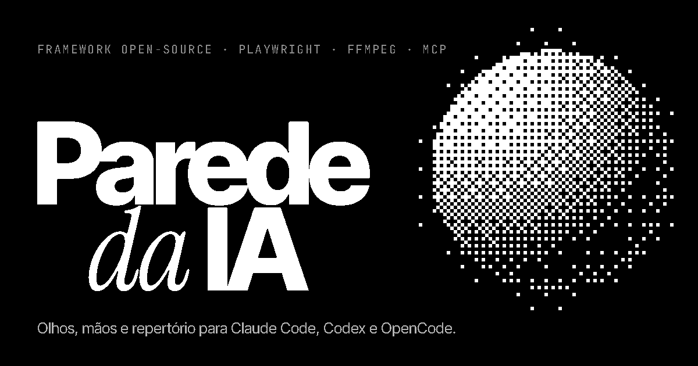
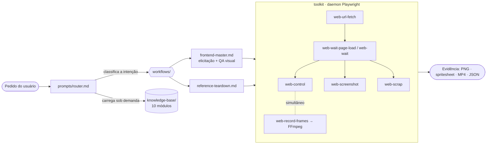

<p align="center">
  <a href="https://anthophicous.github.io/parede-da-ia/"></a>
</p>

<p align="center">
  <a href="https://anthophicous.github.io/parede-da-ia/"></a>
  <a href="LICENSE"></a>
  
  
  
  
</p>

<h3 align="center">Olhos, mãos e repertório para agentes de IA.</h3>

<p align="center">
  Rootkit de inspeção web + motor de direção de arte que transforma <b>Claude Code</b>, <b>Codex</b>,
  <b>OpenCode</b> (e qualquer CLI agêntica) em críticos de design e engenheiros front-end nível Awwwards.
</p>

---

## Por quê

Agentes de IA escrevem front-end sem nunca ver o que construíram. Eles não sentem o scroll, não
medem o contraste, não percebem o pre-loader travado nem o botão que quebra no mobile.

O **parede-da-ia** resolve isso em duas camadas:

1. **Toolkit (`/toolkit`)** — comandos `web-*` sobre **Playwright + FFmpeg** para o agente abrir,
   rolar, clicar, gravar frames, tirar screenshots e dissecar qualquer site (stack, fontes, paleta,
   shaders, contraste, rede).
2. **Router de prompts (`/prompts`)** — em vez de um prompt monolítico, um despachante que carrega
   sob demanda só os módulos necessários, destilados de **10 livros clássicos** de engenharia e design.

## Instalação em 1 comando

Cole no seu agente (Claude Code, Codex, OpenCode, Cursor, Windsurf, Gemini CLI):

```text
Instale o parede-da-ia no meu ambiente.
Leia https://raw.githubusercontent.com/AnThophicous/parede-da-ia/main/doc.md
e execute todas as etapas na ordem, verificando a saída de cada uma antes de seguir.
Use o meu terminal; se algo exigir permissão de administrador, me pergunte antes.
No final, mostre o resultado do `parede doctor` e em quais agentes o router foi registrado.
```

<details>
<summary>Instalação manual</summary>

```bash
git clone --depth 1 https://github.com/AnThophicous/parede-da-ia.git ~/.parede-da-ia
cd ~/.parede-da-ia/toolkit && npm install && npx playwright install chromium
npm link                       # coloca web-* e parede no PATH
parede setup --agent auto      # registra o router no Claude Code / Codex / OpenCode / Gemini / Windsurf
parede doctor
```

Passo a passo completo (inclui FFmpeg, MCP e troubleshooting): [`doc.md`](doc.md).
</details>

## Arquitetura



```
parede-da-ia/
├── doc.md                    instalador universal lido pelo agente
├── prompts/
│   ├── router.md             ponto de entrada (despachante)
│   ├── knowledge-base/       01…10 — heurísticas e checklists por livro
│   └── workflows/            frontend-master.md · reference-teardown.md
├── skill/SKILL.md            template da skill do Claude Code
├── toolkit/                  CLI + daemon + servidor MCP (TypeScript)
│   ├── src/core/             sessão, RPC, parser de ações, FFmpeg
│   ├── src/daemon/           Chromium persistente, controle, gravação, scrap
│   ├── src/inject/           hooks e scanner injetados no DOM
│   └── src/mcp/              JSON-RPC sobre stdio
└── docs/                     landing page (GitHub Pages)
```

Os comandos são clientes leves de um **daemon local** (127.0.0.1 + token) que mantém um único
Chromium vivo entre chamadas. Por isso o estado persiste, o listener de rede roda a sessão inteira
e `web-control` pode disparar **enquanto** `web-record-frames` grava.

## Vitrine da toolkit

| Comando | O que faz |
|---------|-----------|
| `web-url-fetch <url>` | Abre a URL num Chromium persistente e injeta hooks (canvas, shaders GLSL, WAAPI, rAF, console). Aceita `localhost:5173`, arquivos locais, `--mobile`, `--viewport`, `--dpr`, `--headful`. |
| `web-wait-page-load` | Espera `load` + `networkidle` (limitado) + fontes + 2 frames. Detecta pre-loaders de tela cheia e avisa. |
| `web-wait <s>` | Fallback para pre-loaders em canvas/WebGL; `--until-hidden "<seletor>"` espera o loader sumir. |
| `web-control <ação>` | Eventos **reais**: `scroll-down`, `scroll-up`, `scroll-to`, `click`, `hover`, `mousemove`, `keypress`, `type`, `inventory` e `sequence "a; b; c"`. Detecta scroll virtual (WebGL/transform). |
| `web-record-frames` | Screencast do compositor a cada **0.5s** (padrão) → frames + **spritesheet** + **MP4** (+ GIF) via FFmpeg. `--while "<ações>"` encadeia; `--detach`/`--stop` para gravação em background. |
| `web-screenshot` | Alta definição (DPR re-rasterizado via `clip.scale`), viewport, página inteira ou elemento, sem scrollbars/caret. `--viewport 390x844` para responsividade. |
| `web-scrap` | **Wappalyzer de front-end**: frameworks e libs (GSAP, Lenis, Three.js…), hosting, fontes e provedores (Google/Adobe/self-hosted), ícones (Lucide, Phosphor…), paleta exata (variáveis CSS + cores por área), **contraste WCAG**, escala tipográfica, grid de espaçamento, mídia, shaders e rede. JSON completo + resumo. |
| `web-serve <pasta> --detach` | Servidor estático sem cache para o loop de QA. |
| `parede doctor` · `parede setup` | Diagnóstico da instalação e registro idempotente do router nos agentes. |
| `parede-mcp` | Os mesmos comandos como ferramentas MCP (stdio). |

```bash
web-url-fetch https://seu-site.com && web-wait-page-load
web-scrap                                                     # stack, fontes, paleta, contraste
web-record-frames --while "scroll-down 4000 --steps 80" --interval 0.25
web-control hover "a.cta" --hold 600ms --screenshot
web-screenshot --viewport 390x844 --full-page
web-close
```

> ⚠ **Consumo:** cada frame é uma captura real. Intervalos abaixo de `0.1s`, viewports enormes ou
> cenas WebGL pesadas exigem bastante CPU/RAM/GPU. Em máquinas modestas use `--interval 0.25–0.5`
> e viewport ≤ 1440px. O manifesto de cada gravação informa `laggedFrames`.

## A base de 10 livros

| # | Módulo | Obra |
|---|--------|------|
| 01 | Legibilidade, funções pequenas, nomes | *Clean Code* — Robert C. Martin |
| 02 | Regra da dependência, UI como detalhe | *Clean Architecture* — Robert C. Martin |
| 03 | Navegação óbvia, carga cognitiva | *Don't Make Me Think, Revisited* — Steve Krug |
| 04 | Percepção, atenção, conversão | *100 Things Every Designer Needs to Know About People* — Susan Weinschenk |
| 05 | Hierarquia, espaçamento, tipografia | *Refactoring UI* — Adam Wathan & Steve Schoger |
| 06 | DRY, ortogonalidade, tracer bullets | *The Pragmatic Programmer* — Andrew Hunt & David Thomas |
| 07 | Commits atômicos, histórico semântico | *Pro Git* — Scott Chacon & Ben Straub |
| 08 | Telemetria, avaliação contínua | *Designing Machine Learning Systems* — Chip Huyen |
| 09 | Direção, formato, exemplos, decomposição | *Prompt Engineering for Generative AI* — James Phoenix & Mike Taylor |
| 10 | Confiabilidade, consistência, fluxo assíncrono | *Designing Data-Intensive Applications* — Martin Kleppmann |

Os módulos são **destilações autorais** (heurísticas e checklists para agentes), não transcrições.
Os livros pertencem aos seus autores — leia os originais.

## Protocolo `frontend-master`

1. **Elicitação obrigatória** — nada de código antes de saber o objetivo e o *ápice visual*, como os
   assets serão geridos (código/SVG/WebGL, fornecidos ou de referência) e se há referências ou se o
   agente deve pesquisar no Awwwards e propor 2–3 direções.
2. **Loop autônomo de QA visual** — sobe o servidor, abre o próprio trabalho, clica em todos os
   interativos, testa hover/foco/scroll, grava frames, mede contraste e corrige até zerar os problemas.

A landing page deste repositório passou por esse loop usando a própria toolkit: paleta 100% acromática
verificada pelo `web-scrap`, zero falhas de contraste, zero erros de console e sem overflow em 390px.

## Desenvolvimento

```bash
cd toolkit
npm install          # compila via "prepare"
npm run typecheck
npm run smoke        # teste ponta a ponta de todos os comandos
```

Variáveis: `PAREDE_SESSION` (sessões paralelas), `PAREDE_OUT` (pasta de artefatos, padrão `./.parede`),
`PAREDE_FFMPEG`, `PAREDE_GPU=0` (força SwiftShader), `PAREDE_IDLE_MINUTES` (padrão 30).

## Licença

[MIT](LICENSE) © 2026 Brenno Leon
